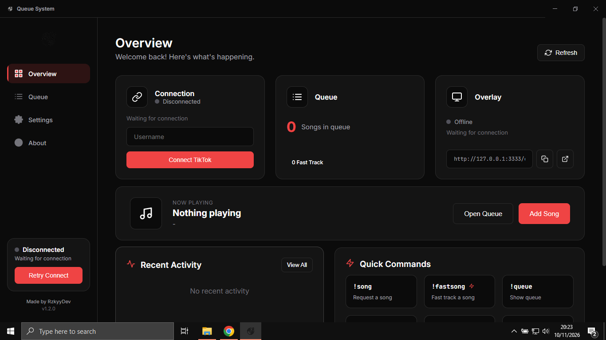
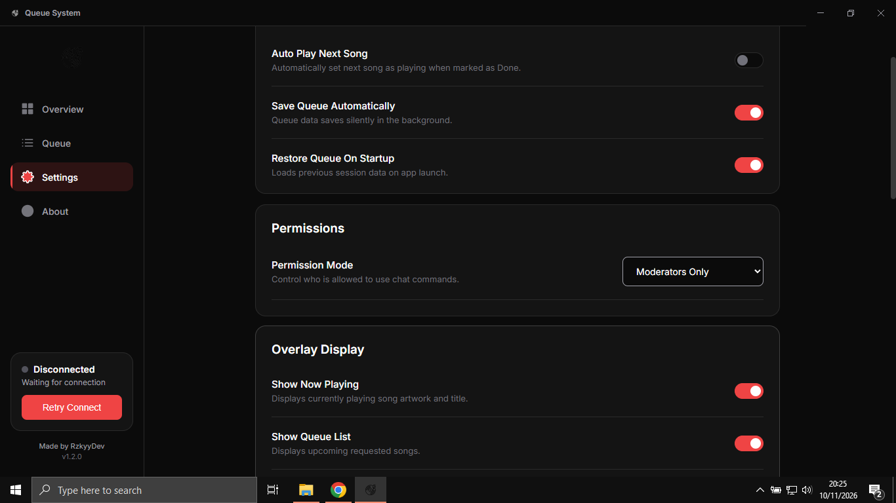

# Queue System

<p align="center">
  
</p>

<h3 align="center">A simple way to manage TikTok LIVE song requests.</h3>

<p align="center">
  Manage song requests, organize your queue, and display everything through a real-time streaming overlay.
</p>

<p align="center">
  <a href="https://github.com/rzkyydev/queue-system/releases">
    
  </a>
  
  
  
  
  
</p>

<p align="center">
  
</p>

---

## About

Queue System is a desktop application designed to make managing song requests during TikTok LIVE sessions easier.

Managing song requests through a busy live chat can get messy pretty quickly. Queue System brings everything together in one place, allowing streamers and moderators to manage requests without constantly scrolling through chat.

It also includes a built-in localhost overlay that can be used as a Browser Source in OBS Studio, TikTok LIVE Studio, and other streaming platforms.

Less time managing requests, more time focusing on your stream.

## Features

| Feature | Description |
|---|---|
| Queue Management | Organize and manage incoming song requests. |
| Fast Track | Give selected requests priority in the queue. |
| Now Playing | Keep track of the currently playing song. |
| Chat Commands | Manage requests directly through TikTok LIVE chat. |
| Moderator Permissions | Control who can use queue commands. |
| Custom Commands | Customize command aliases. |
| OBS Overlay | Display your queue through a local Browser Source. |
| Real-time Updates | Keep queue information synchronized with the overlay. |
| Overlay Customization | Configure visibility, animations, and display options. |
| Automatic Queue Storage | Save and restore queue data between sessions. |

## Screenshots

## Screenshots

<p align="center">
  
<br><br>
  <br><br>

  <div align="center">
  <a href="https://rzkyydev.github.io/queue-system/#overlay">
    
  </a>
  <br>
  <sub>Preview and explore the live overlay directly in your browser.</sub>
</div>

## Installation

### Option 1: Download the Installer

The easiest way to get started is by downloading a pre-built version.

1. Visit the [Releases](https://github.com/rzkyydev/queue-system/releases) page.
2. Download the latest Windows installer.
3. Run the downloaded installer.
4. Follow the installation instructions.
5. Launch Queue System.

You can also download the portable version if you don't want to install the application.

### Option 2: Run from Source

If you want to explore the source code or run the application yourself, you can start with the following steps.

**Requirements**

- Node.js
- npm
- Git (optional)

**1. Clone the repository**

```bash
git clone https://github.com/rzkyydev/queue-system.git
cd queue-system
```

**2. Install dependencies**

```bash
npm install
```

**3. Start the application**

```bash
npm start
```

That's it. The Electron application should now launch on your desktop.

## Build

Want to create your own installer or portable application?

Queue System uses Electron Builder to package the application.

**Build an unpacked application:**

```bash
npm run pack
```

**Build distributable packages:**

```bash
npm run dist
```

Generated files will be available in the `dist/` directory.

### Supported Build Targets

| Platform | Format | Architecture |
|---|---|---|
| Windows | NSIS Installer | x64 |
| Windows | Portable | x64 |

## Getting Started

### 1. Connect TikTok LIVE

1. Open Queue System.
2. Navigate to the connection section.
3. Enter your TikTok username.
4. Click Connect.
5. Wait for the connection to establish.

Make sure your TikTok account is currently hosting a LIVE session.

### 2. Configure Permissions

Queue System provides several permission modes to control who can use chat commands.

| Permission | Description |
|---|---|
| Everyone | Allow everyone to use commands. |
| Moderator Only | Only moderators can use commands. |
| Whitelist | Only selected usernames can use commands. |
| Moderator or Whitelist | Allow moderators and whitelisted users. |

You can also customize command aliases to fit your streaming setup.

### 3. Configure the Overlay

Queue System includes a built-in localhost overlay server.

You can configure:

- Show or hide the queue.
- Show or hide Now Playing.
- Show or hide requester names.
- Show or hide Fast Track badges.
- Queue display count.
- Cassette animation.
- Animation speed.
- Hide overlay when the queue is empty.

### 4. Add the Overlay to OBS

The built-in overlay can be used with OBS Studio and other streaming software that supports Browser Sources.

1. Open Queue System.
2. Open OBS Studio.
3. Add a new Browser Source.
4. Set the URL to:

```text
http://127.0.0.1:3333/overlay
```

5. Adjust the width and height to fit your scene.
6. Position the overlay wherever you want.

The overlay automatically receives updates when queue information changes.

**Important:** Queue System must remain running while you're using the overlay. The local server is hosted by the application.

### Supported Streaming Platforms

- OBS Studio
- TikTok LIVE Studio
- Other software that supports Browser Sources.

## Chat Commands

Queue System supports chat commands that allow streamers and authorized viewers to manage song requests directly from TikTok LIVE chat.

Commands can be customized through the application settings.

### Available Commands

| Command | Description | Example |
|---|---|---|
| `!song` | Add a song request. | `!song Perfect` |
| `!fastsong` | Add a priority request. | `!fastsong Numb` |
| `!play` | Move a request to Now Playing. | `!play 2` |
| `!done` | Mark a song as completed. | `!done` |
| `!remove` | Remove a request. | `!remove 2` |
| `!skip` | Skip the current song. | `!skip` |
| `!queue` | Check the queue count. | `!queue` |
| `!now` | Check the currently playing song. | `!now` |
| `!clear` | Clear the entire queue. | `!clear` |

### Default Command Aliases

| Command | Aliases |
|---|---|
| `!song` | `!s` |
| `!fastsong` | `!fs` |
| `!play` | `!p` |
| `!done` | `!d` |
| `!remove` | `!r` |
| `!skip` | `!sk` |
| `!queue` | `!q` |
| `!now` | `!np` |
| `!clear` | `!c` |

### Requesting for Another Viewer

Moderators can submit song requests on behalf of another viewer.

**Command format:**

```text
!song @username song name
```

**Example:**

```text
!song @viewer99 Perfect
```

The request will be added under the specified username.

You can also use the Fast Track command:

```text
!fastsong @viewer99 Numb
```

## Project Structure

```text
queue-system/
├── src/
│   ├── main/
│   │   ├── services/
│   │   │   ├── activity.service.js
│   │   │   ├── command.service.js
│   │   │   ├── queue.service.js
│   │   │   ├── queue-storage.js
│   │   │   ├── settings.service.js
│   │   │   └── tiktok.service.js
│   │   ├── server/
│   │   │   └── overlay.server.js
│   │   ├── preload/
│   │   │   └── preload.js
│   │   └── index.js
│   ├── overlay/
│   │   ├── overlay.html
│   │   ├── overlay.css
│   │   └── overlay.js
│   └── renderer/
│       ├── components/
│       ├── assets/
│       ├── app.js
│       ├── index.html
│       ├── store.js
│       └── styles/
├── docs/
├── package.json
└── README.md
```

## Technologies

Queue System is built with a lightweight desktop architecture using familiar web technologies.

| Technology | Purpose |
|---|---|
| Electron | Desktop application framework. |
| JavaScript | Application logic and functionality. |
| Node.js | Backend runtime. |
| HTML5 | Application and overlay structure. |
| CSS3 | Application and overlay styling. |
| Electron Builder | Application packaging and distribution. |
| piratetok-live-js | TikTok LIVE connectivity. |

## Data & Storage

Queue System stores its application data locally.

Settings, command configurations, and queue data are handled through local application storage.

The application uses Electron's user data directory for persistent settings.

On Windows, this is generally located under:

```text
%APPDATA%/queue-system/
```

The exact directory depends on the Electron application name and environment.

No separate hosted database is required for the local application.

## Troubleshooting

**TikTok LIVE connection is not working**

- Make sure the TikTok account is currently LIVE.
- Check your username.
- Check your internet connection.
- Try reconnecting.

**OBS overlay is not updating**

- Make sure Queue System is running.
- Verify the Browser Source URL.
- Refresh the Browser Source.
- Check whether port `3333` is available.

**Chat commands are not responding**

- Check your configured permission mode.
- Verify the command alias.
- Make sure the TikTok connection is active.
- Confirm that the sender is authorized to use commands.

**Application fails to start**

- Make sure your system supports the application build.
- Try reinstalling the application.
- If running from source, reinstall dependencies using `npm install`.

## Contributing

Contributions, suggestions, and bug reports are welcome.

If you have an idea that could improve Queue System or find something that doesn't work as expected, feel free to open an issue or submit a pull request.

Please include enough information to explain the issue or improvement.

## License

Queue System is distributed under a proprietary license.

Copyright © 2026 RzkyyDev. All rights reserved.

See the `LICENSE` file for additional information.

## Developer

**RzkyyDev**

<p align="center">
  <a href="https://github.com/rzkyydev">
    
  </a>
</p>

---

<p align="center">
  Made for streamers, built for simplicity.
</p>
